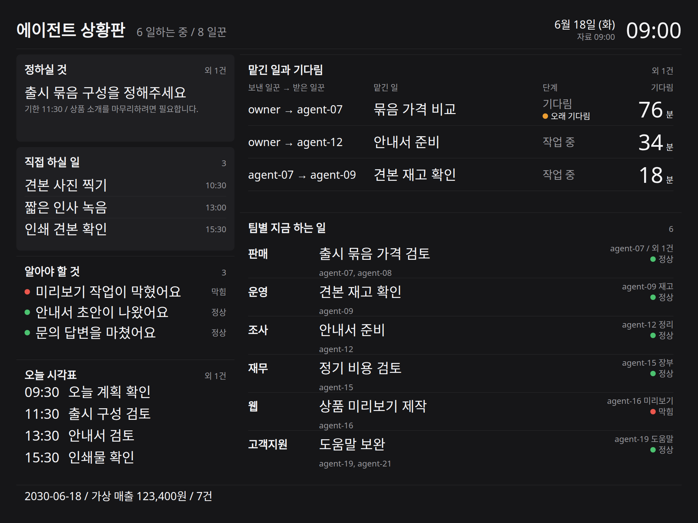
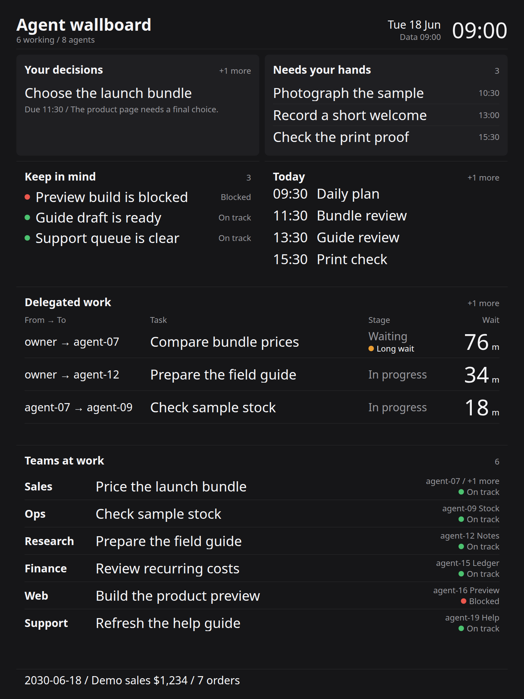

# agent-wallboard

오래된 태블릿을 AI 에이전트 팀과 그 팀을 운영하는 한 사람을 위한 차분한 벽걸이 상황판으로 바꿉니다.

[English](README.md)



## 만든 이유

에이전트들과 함께 작은 사업체를 혼자 운영하는 사람에게는 세 가지 답이 필요합니다. 내가 결정할 일은 무엇인가, 내 손이 직접 가야 할 일은 무엇인가, 지금 누가 무엇을 하고 있는가입니다. 이 상황판은 그 세 가지를 늘 눈에 보이는 곳에 두고 짧은 일정표와 자금 현황 한 줄을 함께 보여 줍니다.

파이썬 기본 라이브러리와 태블릿 브라우저만으로 동작합니다. 외부 네트워크 요청이나 내장 글꼴 파일, 계정, 별도 프레임워크에 의존하지 않습니다. 함께 들어 있는 영어와 한국어 예시의 업무 내용과 금액은 모두 가상의 값입니다.

## 설치와 실행 3단계

1. 저장소를 내려받아 압축을 풀고, 해당 폴더에서 터미널을 엽니다.
2. `python3 server.py --host 0.0.0.0`을 실행합니다. 파이썬 3.10 이상이 필요합니다. 기본 데이터는 `demo/demo.json`, 기본 포트는 `8792`입니다.
3. 같은 네트워크에 연결된 태블릿에서 `http://<컴퓨터-주소>:8792/pad?lang=en`을 열고 브라우저를 전체 화면 모드로 바꿉니다. 서버를 띄운 컴퓨터에서는 `http://127.0.0.1:8792/pad`로 확인할 수 있습니다.

`python3 server.py`만 실행하면 실행한 컴퓨터에서만 접속할 수 있습니다. `--host 0.0.0.0`을 붙여야 태블릿에서도 접속됩니다. 로그인 화면이 없는 읽기 전용 상황판이므로 신뢰할 수 있는 네트워크에서 사용하세요.

한국어 예시는 다음과 같이 실행합니다.

```sh
python3 server.py --data demo/demo.ko.json --port 8792 --host 0.0.0.0
```

브라우저에서 `/pad?lang=ko`를 엽니다. 주소의 언어 설정은 화면의 안내 문구만 바꾸고, 실제 업무 내용은 JSON 파일에 적힌 글을 그대로 가져옵니다.

## 내 자료 연결하기

직접 만든 스크립트에서 [자료 칸 설명](docs/schema.md)에 맞춰 UTF-8 JSON 파일을 기록하게 한 뒤, `python3 server.py --data data/board.local.json`으로 서버를 시작하면 됩니다. 화면이나 서버 코드를 따로 고칠 필요는 없습니다.

화면은 1분마다 `/pad.json`을 새로 읽습니다. 파일이 없거나 깨져 있으면 읽기 경고를 띄우고 마지막으로 정상 수신한 화면을 그대로 유지합니다. `/healthz`는 서버가 실행 중인지 확인합니다. 각 영역을 누르면 줄여서 표시된 전체 문장과 화면 줄 수를 넘긴 나머지 항목까지 읽을 수 있습니다.

## 디자인 원칙

- 색은 상태를 나타낼 때만 쓰고, 상태 점 옆에는 뜻을 글자로 함께 적습니다.
- 글자 크기는 기준 화면에서 64, 48, 40, 32, 24 다섯 가지만 씁니다.
- 배경을 채운 카드는 결정할 일과 직접 손봐야 할 일 두 영역에만 씁니다.
- 값이 바뀌면 줄을 움직이지 않고 바뀐 값 아래에만 0.8초 동안 밑줄을 긋습니다.
- 화면에 보일 줄 수를 제한하되 기한과 금액은 잘리지 않게 보존하고, 비어 있는 자료와 읽지 못한 자료를 구분합니다.

화면 배치는 2048 × 1536 가로 화면을 기준으로 비례해 조절되며, 세로 화면에서는 영역을 다시 배치합니다. 1170 × 878 해상도에서도 동작을 확인합니다. 글꼴 파일은 따로 넣지 않고 기기에 설치된 Apple SD Gothic Neo, Pretendard, Noto Sans KR, 시스템 기본 글꼴 순서로 불러옵니다.



## 검사와 화면 사진

```sh
python3 -m unittest -v
```

화면 캡처와 브라우저 검사는 선택 패키지인 Playwright를 설치한 뒤 실행합니다.

```sh
python3 -m pip install playwright
python3 -m playwright install chromium
python3 tools/screenshot.py
```

실행하면 `docs/screenshot-en.png`와 `docs/screenshot-ko.png`는 2048 × 1536으로, `docs/screenshot-portrait.png`는 1536 × 2048로 저장됩니다. 임시 로컬 서버를 띄워 가상의 예시 데이터만 사용하며, 화면 배치와 주기적 갱신, 변경 표시, 빈 상태, 오류 복구, 외부 요청 차단 여부를 함께 확인합니다.

## 라이선스

[MIT](LICENSE)
