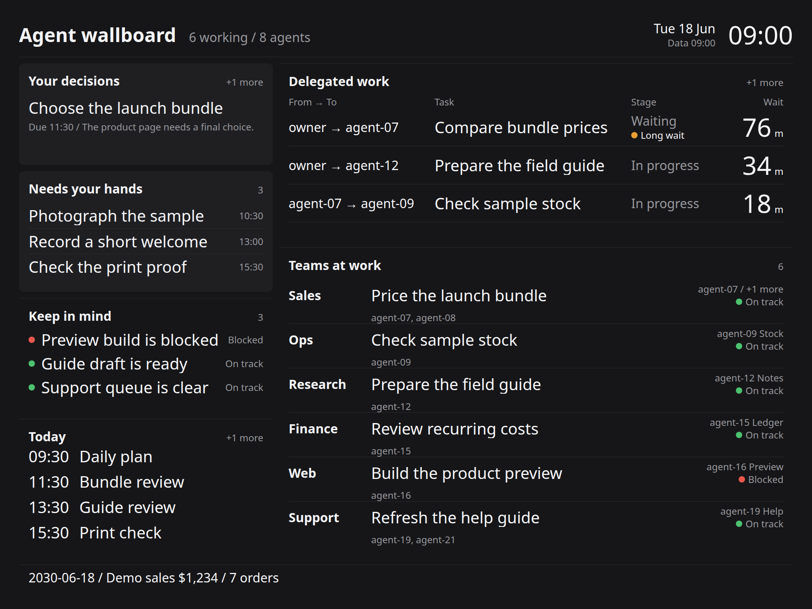
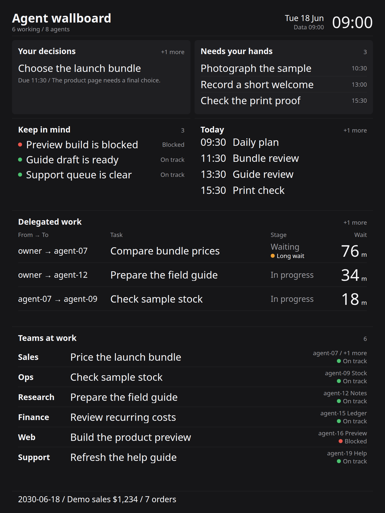

# agent-wallboard

Turn an old tablet into a calm wall display for a team of AI agents and the one person who runs them.

[한국어](README.ko.md)



## Why

One person running a small business with agents needs three answers: what must I decide, what needs my hands, and who is doing what right now? This board keeps those answers in view, along with a short schedule and one money line.

It runs on Python's standard library and a tablet browser. There are no outside requests, bundled fonts, accounts, or framework dependencies. The included English and Korean snapshots contain invented work and amounts.

## Start in three steps

1. Download and unpack this repository, then open its folder in a terminal.
2. Run `python3 server.py --host 0.0.0.0`. Python 3.10 or newer is required. The default data is `demo/demo.json`, and the default port is `8792`.
3. On a tablet on the same network, open `http://<computer-address>:8792/pad?lang=en` and use the browser's full-screen mode. On the computer itself, use `http://127.0.0.1:8792/pad`.

Plain `python3 server.py` listens on the computer itself at `127.0.0.1`. Adding `--host 0.0.0.0` makes it reachable from your tablet. This is a read-only display for a trusted network and does not include a login screen.

For the Korean example, run:

```sh
python3 server.py --data demo/demo.ko.json --port 8792 --host 0.0.0.0
```

Open `/pad?lang=ko`. The query changes interface labels, while the JSON supplies the work text.

## Connect your data

Have your own script write a UTF-8 JSON snapshot following [the schema](docs/schema.md). Start the server with `python3 server.py --data data/board.local.json`. No changes to the page or server are needed.

The display polls `/pad.json` every minute. A missing or broken file produces a visible load warning and keeps the last good snapshot on screen. `/healthz` checks whether the server is running. Tap a section to read the full text, including rows beyond the visible limit.

## Design principles

- Use color only for status, with a written label beside each status dot.
- Use five type sizes: 64, 48, 40, 32, and 24 at the reference size.
- Give decisions and hands-on work the only filled cards.
- Underline changed values for 0.8 seconds and keep rows still.
- Limit visible rows, preserve deadlines and money, and distinguish empty data from failed data.

The layout scales from a 2048 × 1536 landscape canvas and rearranges for portrait. It is checked at 1170 × 878 as well. Fonts come from the device: Apple SD Gothic Neo, Pretendard, Noto Sans KR, then system fallbacks.



## Check and capture

```sh
python3 -m unittest -v
```

Screenshots and browser checks use the optional Playwright package:

```sh
python3 -m pip install playwright
python3 -m playwright install chromium
python3 tools/screenshot.py
```

This writes `docs/screenshot-en.png` and `docs/screenshot-ko.png` at 2048 × 1536, plus `docs/screenshot-portrait.png` at 1536 × 2048. It starts temporary local servers, uses only the invented snapshots, and checks layout, polling, change marks, empty states, failure recovery, and local requests.

## License

[MIT](LICENSE)
